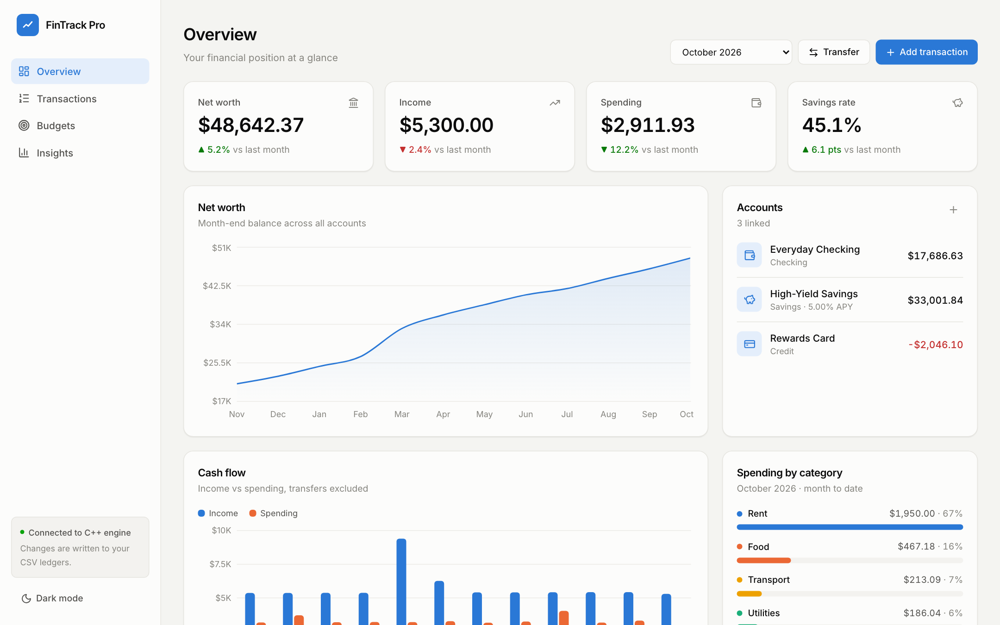
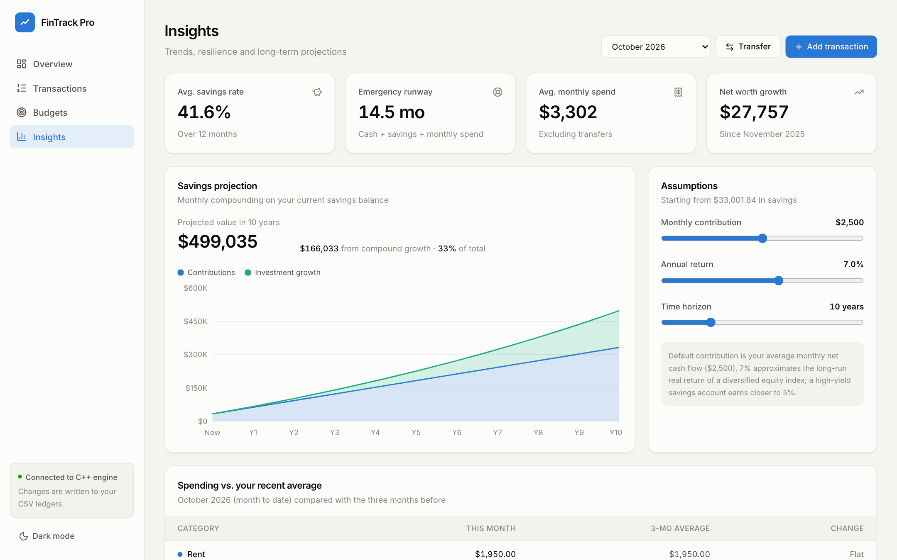
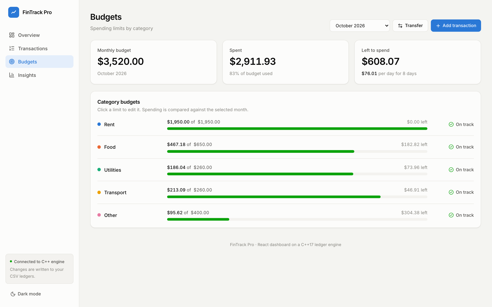
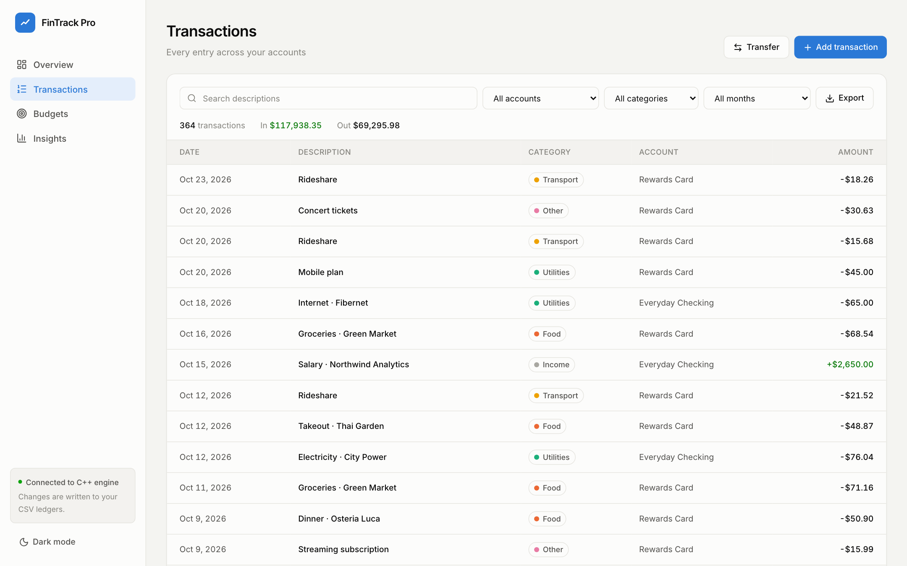
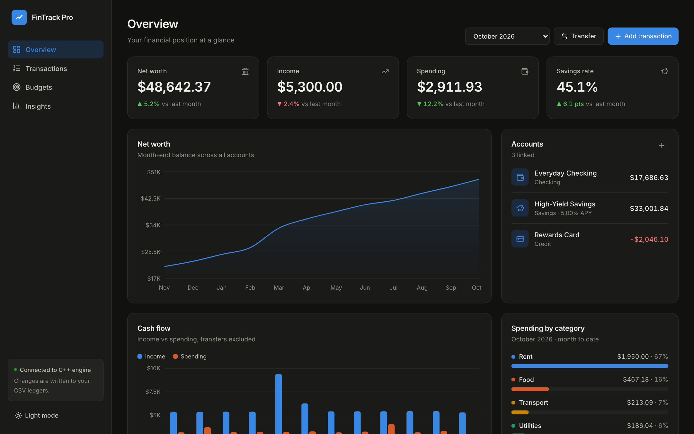
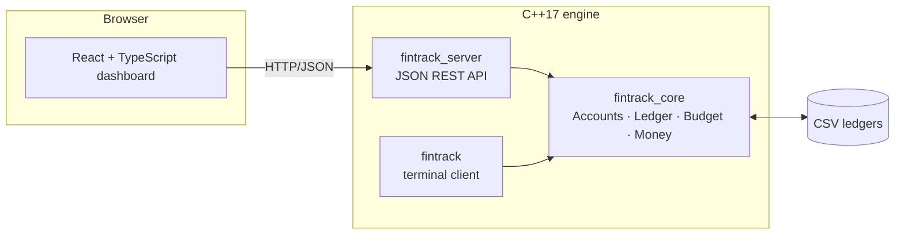

# FinTrack Pro

**A personal finance dashboard built on a C++17 ledger engine.**

FinTrack Pro tracks checking, savings and credit accounts, then turns the raw ledger into the figures that matter: net worth over time, cash flow, savings rate, budget variance, emergency-fund runway, and a compound-growth projection.

**[Live demo →](https://timmsr.github.io/FinTrackPro/)** (runs on generated sample data in your browser)



<table>
  <tr>
    <td></td>
    <td></td>
  </tr>
  <tr>
    <td></td>
    <td></td>
  </tr>
</table>

## Features

| | |
|---|---|
| **Overview** | Net worth, income, spending and savings rate with month-over-month change; net worth trend; cash flow by month; spending mix by category |
| **Transactions** | Search and filter across all accounts, add income/expenses, transfer between accounts, export to CSV |
| **Budgets** | Per-category limits with variance, status, and a daily "safe to spend" allowance for the rest of the month |
| **Insights** | Average savings rate, emergency-fund runway, interactive compound-interest projection, spending vs. 3-month average |
| **Accounts** | Checking, high-yield savings (monthly interest at APY/12) and credit card, each with its own rules |

Light and dark themes, responsive down to phone width.

## Architecture



- **`fintrack_core`**: the domain model. `Account` is a polymorphic base for `CheckingAccount` (monthly fee), `SavingsAccount` (interest) and `CreditAccount` (limit). Each account owns a `Ledger`; `TransferTransaction` posts a matching debit and credit so money is never created or destroyed.
- **`fintrack_server`**: a small REST API (cpp-httplib + nlohmann/json) with a mutex-guarded store. Every change is written back to the CSV ledgers.
- **Web dashboard**: React 19, TypeScript, Tailwind CSS and Recharts. All analytics are pure functions in [`web/src/lib/analytics.ts`](web/src/lib/analytics.ts). The same UI runs against an in-browser data layer for the static demo.

### Design decisions

- **Money is stored as integer cents** (`long long` in C++, integers over the API) to avoid floating-point drift. Interest is the only place that multiplies, and it rounds once.
- **Transfers are excluded from income and spending.** Moving $1,200 to savings is not an expense, and paying the credit card isn't either; only the original purchases count.
- **Savings rate** = (income − spending) / income for the month.
- **Emergency runway** = (checking + savings) / average monthly spending over the last three complete months.
- **Projection** compounds monthly: `B(t+1) = B(t) · (1 + r/12) + contribution`.

## Running locally

Requirements: CMake ≥ 3.16, a C++17 compiler, and Node.js ≥ 23.6 (runs the TypeScript sample generator natively).

```bash
# 1. Build the engine and run the tests
cmake -S . -B build -DCMAKE_BUILD_TYPE=Release
cmake --build build -j
ctest --test-dir build --output-on-failure

# 2. Generate 12 months of sample data into ./data (optional)
npm --prefix web install
npm --prefix web run sample

# 3a. Development: API on :8080, hot-reloading UI on :5173
./build/fintrack_server --data data
npm --prefix web run dev

# 3b. Or build the UI once and let the server host everything on :8080
npm --prefix web run build
./build/fintrack_server --data data --static web/dist
```

The original terminal client is still available as `./build/fintrack`.

### API

| Method | Path | Body |
|---|---|---|
| `GET` | `/api/accounts` | |
| `POST` | `/api/accounts` | `{ name, type: "checking" \| "savings" \| "credit" }` |
| `GET` | `/api/transactions` | |
| `POST` | `/api/transactions` | `{ account, date: "YYYY-MM-DD", amount: cents, category, note }` |
| `POST` | `/api/transfers` | `{ from, to, date, amount: cents }` |
| `GET` | `/api/budgets` | |
| `PUT` | `/api/budgets` | `{ category, limit: cents }` |

Validation errors return `400` with `{ "error": "..." }`.

## Project layout

```
src/
  core/          Money, Transaction, Ledger, Category, terminal client
  accounts/      Account hierarchy
  transactions/  Recurring and transfer transactions
  users/         User, Budget
  io/            CSV persistence
  server/        REST API
tests/           Unit tests (ctest)
web/             React dashboard, sample-data generator
third_party/     cpp-httplib, nlohmann/json (single header)
```

## Roadmap

- Import bank statements (OFX/CSV mapping)
- Custom categories and merchant rules
- Investment accounts with holdings and time-weighted return
